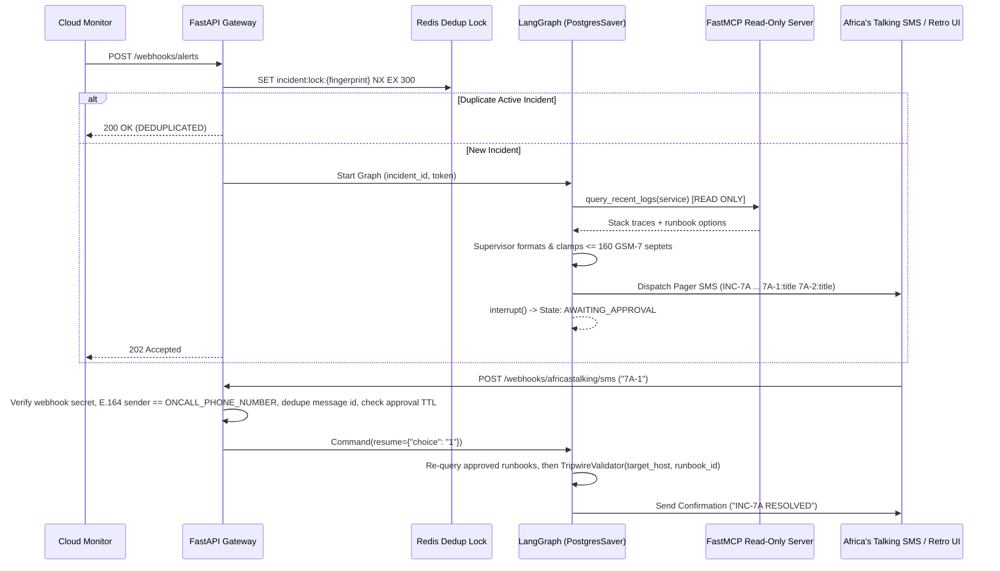

# Design Document: Pagemaster Incident Response System

## Overview
Pagemaster implements a stateful supervisor-worker orchestration graph backed by FastAPI, PostgreSQL, Redis, and the Model Context Protocol (MCP). Deterministic Python gates wrap every LLM boundary to enforce idempotency, 160-septet (GSM-7) pager formatting, webhook authentication with a sender allowlist, and a time-of-check/time-of-use (TOCTOU) safe Tripwire.

## Architecture & State Flow

## Correctness Properties

- **Property 1: Pager payload invariant.** For any diagnosis text, `format_pager_payload` returns ASCII text of length <= 160 that starts with `INC-<TOKEN>`, contains both `<TOKEN>-1` and `<TOKEN>-2`, and contains no email, IPv4, IPv6, or bearer token. (Req 3.1, 3.2, 3.3)
- **Property 2: Deduplication idempotence.** For any sequence of alerts sharing a `(service_name, error_code)` fingerprint while an incident is active, exactly one agent run starts and every later alert returns `DEDUPLICATED`. (Req 1.2)
- **Property 3: SMS reply parsing.** `parse_sms_reply` accepts only `<TOKEN>-1` or `<TOKEN>-2` (case and surrounding whitespace tolerant) for a known token and returns no action for any other input. (Req 4.4, 4.5)
- **Property 4: Tripwire soundness.** `TripwireValidator` passes if and only if the target host equals the incident `service_name` and the action ID is in the approved runbook set. (Req 5.2)
- **Property 5: Audit chain integrity and RESOLVED gating.** Each audit record's hash equals SHA-256 of its content plus the previous hash, so any mutation is detected. An incident reaches `RESOLVED` only when `tripwire_check_passed`, `simulated_step_executed`, `confirmation_sms_sent`, and `audit_record_committed` are all true. (Req 5.3, 5.4, 5.5)
- **Property 6: Failed runs end FAILED and free the fingerprint.** For any workflow outcome, `RESOLVED` is persisted only when all four gating flags are true. An executor partial failure (status `EXECUTING` with any flag false), a `RESOLVED` result with a missing flag, or an unhandled workflow exception moves the incident to `FAILED`, appends an audit event, and releases the dedup lock; every terminal state (`RESOLVED`, `BLOCKED_BY_TRIPWIRE`, `FAILED`) frees the fingerprint. (Req 5.4, 5.5, 5.6)

## Persistence and Lifecycle Notes

- `FAILED` is a terminal state. It is excluded from the partial unique indexes `uq_incidents_active_token` and `uq_incidents_active_fingerprint`, and is allowed by the `state` CHECK in `database/10_schema.sql`.
- `IncidentRepository.record_resolution(incident_id, status, gates)` writes the state and the four gate flags in one `UPDATE`, so the `resolved_requires_all_gates` CHECK holds. `None` flags keep their stored value (`COALESCE`). `_run_workflow` reads `gates` from the graph result and uses this method for every state it writes; it never writes `RESOLVED` unless all four flags are true.
- The seed data contains only terminal incidents (`RESOLVED`, `BLOCKED_BY_TRIPWIRE`). Active seeded incidents would hold the dedup fingerprint without a LangGraph checkpoint, so demo alerts would be `DEDUPLICATED` and could not be resumed.

### Database scripts (task 26)

- `database/10_schema.sql` holds tables, constraints, indexes, triggers and views. It is idempotent (`IF NOT EXISTS`, `CREATE OR REPLACE`, `DROP TRIGGER IF EXISTS` then `CREATE TRIGGER`) and contains no database name.
- `database/20_roles.sql` creates `mcp_reader` only when `pg_roles` has no such role and issues every `GRANT`, `REVOKE` and `ALTER ROLE ... IN DATABASE` through `format(... %I, current_database())`, so it works in a database with any name. The `pagemaster` application role is granted `CONNECT` only if it exists. The role password is synced from `MCP_READER_PASSWORD` at app startup.
- `database/30_demo_seed.sql` holds the demo logs, runbooks, terminal incidents and hash-chained audit rows (including the vector rows checked by `test_properties.py`), every `INSERT` guarded by `ON CONFLICT DO NOTHING` or `WHERE NOT EXISTS`. It is applied only in demo mode: compose passes `DEMO_SEED: ${DRY_RUN:-true}` to `database/docker-entrypoint/00_init.sh`, and `scripts/apply_schema.sh` needs `--demo`. A database without it has no demo incidents (Req 11.2); the sentinel incident still comes from `ensure_system_incident` in app code.
- `database/migrations/001_hardening_columns.sql` upgrades databases created from the old `init_mock_logs.sql` (`option_count`, `terminal_at`, `duplicate_count`, state CHECK).

## Property 7-10 (added with the hardening pass)

- **Property 7: Single-SMS septet budget.** For any diagnosis text and any two runbook titles, `format_pager_payload` returns text with `gsm7_septets(text) <= 160`, no character outside GSM-7 (so no UCS-2 fallback), the `INC-<TOKEN>` prefix, and both `<TOKEN>-1:<title>` and `<TOKEN>-2:<title>` action entries. Extension characters count 2 septets. (Req 3.1, 3.2, 3.3)
- **Property 8: Sender authorization.** A reply changes incident state only if the webhook secret matches, the E.164-canonicalized `from` equals `ONCALL_PHONE_NUMBER`, the optional `to` matches the shortcode, and the message `id` has not been processed before. Any other input is rejected with zero state changes. (Req 4.2 to 4.5)
- **Property 9: TOCTOU Tripwire.** The Tripwire re-queries the approved runbooks for the incident `service_name` at execution time. For any runbook revocation between triage and execution, an action that is no longer approved ends in `BLOCKED_BY_TRIPWIRE` with no execution. (Req 5.2)
- **Property 10: Expiry and reconciliation.** For any approval age greater than `APPROVAL_TTL_SECONDS`, a reply performs no mutation and the incident ends `EXPIRED`. Startup reconciliation moves every `TRIAGING` or `EXECUTING` incident to `FAILED`. Both transitions release the fingerprint lock. (Req 6.1 to 6.5)

## SMS Transport: Africa's Talking

- `AfricasTalkingSmsAdapter` (in `backend/app/services/africastalking_client.py`) implements the `SmsPort` protocol with `httpx.AsyncClient`. It targets the sandbox or production endpoint depending on settings and reads `AFRICASTALKING_USERNAME`, `AFRICASTALKING_API_KEY`, `AFRICASTALKING_SHORTCODE`, and `ONCALL_PHONE_NUMBER`. With `DRY_RUN=true` it writes to the in-memory outbox and makes no network call.
- Africa's Talking does not sign inbound callbacks, so the inbound webhook is authenticated by a shared secret (`AFRICASTALKING_WEBHOOK_SECRET`, constant-time comparison) plus an allowlist: the canonical E.164 sender must equal `ONCALL_PHONE_NUMBER`, and the `to` shortcode must match when configured. The AT message `id` is stored for idempotency so redelivered callbacks do nothing.
- The reply `token` is a bearer-like capability, so it never appears in `GET /api/incidents` or in audit payloads returned over the API. The demo UI learns the token from the dry-run outbox only.

## GSM-7 Septet Budget

- `gsm7_septets(text)` counts GSM 03.38 septets: basic-table characters cost 1 and extension-table characters (`^ { } \ [ ~ ] | €`) cost 2. A string with any character outside both tables would force UCS-2 (70 characters per segment), so such characters are transliterated (smart quotes to ASCII quotes, backtick to apostrophe) or dropped before counting.
- The page format is `INC-<TOKEN> <service>: 
. <TOKEN>-1:<t1> <TOKEN>-2:<t2>`. The summary is truncated first; the prefix, token, and both titled options are always preserved.

## Tripwire TOCTOU, Expiry and Reconciliation

- `tripwire_guard` calls `ports.runbooks.list_approved(service_name)` at execution time. Runbooks cached in state during triage are only used to map the reply digit to an action ID; they are not trusted for authorization. The agent package still depends only on the `RunbookPort` protocol.
- `EXPIRED` is a terminal state (excluded from the active unique indexes and allowed by the `state` CHECK). A lifespan reaper task moves `AWAITING_APPROVAL` incidents older than `APPROVAL_TTL_SECONDS` to `EXPIRED`, and a reply is also checked against the TTL when it arrives.
- On startup, orphaned `TRIAGING` and `EXECUTING` incidents (their in-process background task died with the previous process) are moved to `FAILED`, with an audit event and lock release.

## Operability

- `GET /healthz` returns 200 and backs a Docker `healthcheck` on the `backend` service.
- Postgres and Redis are published on `127.0.0.1` only, Redis requires a password, and `backend/requirements.txt` pins versions.

## Multi-Worker Safety, DB Clock and Header Auth

- **Stale-lease reconciliation:** startup reconciliation fails only `TRIAGING`/`EXECUTING` rows with `updated_at <= now() - make_interval(secs => $1)` (`INFLIGHT_STALE_SECONDS`, default 60, minimum 10), in one `UPDATE ... RETURNING`. A worker that boots while another worker is mid-triage therefore leaves fresh incidents alone. An optional Redis leader lock (`pagemaster:reconcile_lock`, NX, 30 s) serializes concurrent boots. Each reclaimed incident gets an `INCIDENT_FAILED` audit record (`stale_inflight_reconciled`) and its dedup lock released. The in-memory repository mirrors the cutoff.
- **DB-clock expiry:** with PostgreSQL, `expire_stale_awaiting(ttl)` and `expire_if_stale(token, ttl)` compare `updated_at` with `now()` inside SQL and return `is_expired` from the query, so application clock skew cannot extend or shorten the approval window. The reply paths (`/webhooks/africastalking/sms`, `/api/demo/reply`) call `expire_if_stale` before resuming the graph.
- **Header-only callback secret:** the Africa's Talking secret is read from `X-Webhook-Secret`, then `Authorization: Bearer`. `?secret=` is ignored unless `ALLOW_QUERY_SECRET=true`, because URLs end up in proxy and access logs.
- **Property 11:** For any set of `TRIAGING`/`EXECUTING` incidents with arbitrary ages and any cutoff, reconciliation fails exactly those older than the cutoff and leaves younger ones and all other states untouched. (Req 6.4)
- **Property 12:** For any combination of header, bearer and query secrets and `ALLOW_QUERY_SECRET`, a reply is accepted only when a permitted source carries the configured secret. (Req 4.2, 4.3)

## Lifecycle sweep (task 16)

- **Periodic sweep:** every reaper tick (`Lifecycle.tick`) first expires stale `AWAITING_APPROVAL` rows, then calls `sweep_inflight`. Both use the store clock (`now()` in Postgres) and parameterized SQL.
- **Stale `TRIAGING`** (`updated_at <= now() - TRIAGE_TIMEOUT_SECONDS`): `renew_stale_triaging` claims the row by refreshing `updated_at` (one worker wins per tick). The lifecycle then asks the injected `resume_triage` callable to resume the graph (`ainvoke(None, thread_id=incident_id)`) when a checkpoint with a pending node exists. With no checkpoint, an empty snapshot, a resume error or a resume timeout, it applies `compare_and_set_state(TRIAGING -> FAILED)`, audits `INCIDENT_FAILED {reason: recovered_after_crash}`, releases the fingerprint lock and sends `INC-<TOKEN> FAILED. Re-send the alert.`
- **Stale `EXECUTING`** (`EXECUTING_TIMEOUT_SECONDS`): `fail_stale_state("EXECUTING", t)` is one compare-and-set `UPDATE ... RETURNING`. Audit reason `execution_timeout`, same cleanup and SMS. The graph is never resumed, so remediation is never re-run.
- **Notifications:** expiry sends `INC-<TOKEN> EXPIRED. No action taken.`; startup reconciliation sends the same `FAILED` text. A reply to an `EXPIRED` incident (found through `latest_by_token`) answers `INC-<TOKEN> expired. No action taken.` and writes nothing. All texts pass `validate_outbound`. Audit payloads carry only the reason.
- **Races:** every transition is a compare-and-set on the state, and a reply's `AWAITING_APPROVAL -> EXECUTING` claim refreshes `updated_at`, so a reply and the reaper cannot both win.
- **Property 13:** for any set of incidents with arbitrary states and ages and any timeouts, after one tick no incident remains non-terminal beyond its timeout (`APPROVAL_TTL_SECONDS`, `TRIAGE_TIMEOUT_SECONDS`, `EXECUTING_TIMEOUT_SECONDS`), and younger ones are untouched. Validates: Requirements 6.8, 6.11.

## Reliable page delivery (task 17)

- **Retry adapter:** `RetryingSmsPort` (`backend/app/services/retrying_sms.py`) wraps the real `SmsPort` handed to the graph. `SmsSendError.retryable` (default `True`) separates transient failures (transport errors, timeouts, HTTP 5xx, 408, 429, recipient status codes >= 500) from permanent ones (other 4xx, authentication, invalid number or recipient status codes below 500, malformed response). Up to `PAGE_MAX_ATTEMPTS` total attempts (default 3, minimum 1) with delays of 1 s, 2 s, 4 s, each stretched by up to 25% jitter. `sleep` and `rand` are injectable. `AppServices.sms` stays the raw adapter, so reply and reaper notifications are not delayed by retries and the dry-run demo routes still see the outbox.
- **Final failure:** `dispatch_pager` calls `ports.sms.send` once and treats any exception as final. It audits `PAGER_FAILED` with `{"reason": "pager_undeliverable"}` only (no phone number, token or provider text), returns status `FAILED` and a conditional edge ends the run before `human_approval_gate`, so no `interrupt` happens. On success it audits `PAGER_SENT`. The old `PAGER_SENT {sent: false}` path no longer exists, so each page yields exactly one of the two events.
- **API layer:** `_apply_result` routes a `FAILED` result through `_fail_incident` (audit `INCIDENT_FAILED` with the reason, persist `FAILED`, release the fingerprint lock). A re-fired alert therefore starts a new incident (`202`).
- **Health:** `HealthState` (`backend/app/services/health_state.py`) is held by `AppServices.health`. `_apply_result` increments `consecutive_page_failures` and sets `last_failure_at` on a `pager_undeliverable` result and resets the counter when the incident reaches `AWAITING_APPROVAL`. Task 23 exposes it through `/readyz`.
- **Property 14: Page attempt count.** For any number `N` of consecutive provider failures and any `PAGE_MAX_ATTEMPTS = M >= 1`, a retryable error series is attempted `min(N + 1, M)` times (one sleep between attempts), a non-retryable error is attempted exactly once with no sleep, and the page is delivered only when `N == 0` or (the error is retryable and `N < M`). (Req 8.1, 8.2, 8.3)

## Truthful page options and no dead ends (task 18)

- **Option count is explicit.** `format_pager_payload(token, service, summary, option_titles=[...])` emits one `<TOKEN>-N:<title>` per entry (at most `MAX_PAGE_OPTIONS = 2`). Without `option_titles` the legacy two-option form from `title1`/`title2` is kept for existing callers. Free text (service, summary, titles) has `<TOKEN>-1`/`<TOKEN>-2` rewritten to `<TOKEN> 1`/`<TOKEN> 2`, so only real options look like reply codes.
- **Zero runbooks:** `INC-<TOKEN> <service>: 
. No approved action. Manual response needed.` carries no reply code. One runbook offers only `<TOKEN>-1`. The last-resort fallback is also truthful (`INC-<TOKEN> No approved action. Manual response needed.`, `INC-<TOKEN> Reply <TOKEN>-1`, or the two-option text).
- **`NO_ACTION` is a terminal state** (`IncidentStatus`, both `TERMINAL_STATUSES`, the `incidents.state` CHECK, the UI label). It is outside the active partial unique indexes, so it frees the token and fingerprint. `supervisor_formatter` stores `option_count` in graph state; with `option_count == 0`, `dispatch_pager` sends the page and returns `NO_ACTION`, and the conditional edge ends the run before `human_approval_gate` (no `interrupt`). `_apply_result` audits `INCIDENT_NO_ACTION` (payload `reason` only), persists the state and releases the lock.
- **Where the option count lives:** a nullable `incidents.option_count SMALLINT CHECK (0..2)` column on the row, not graph state. `record_resolution(..., option_count)` writes it in the same `UPDATE` that moves the incident to `AWAITING_APPROVAL`/`NO_ACTION`, so a reply that sees `AWAITING_APPROVAL` always sees the count, and the reply path needs no checkpoint read. `None` keeps the stored value; rows without a count (older rows) behave as before and the Tripwire still blocks out-of-range choices.
- **Reply to a missing option:** `_handle_reply` (shared by the webhook and `POST /api/demo/reply`) compares the choice with `option_count` before the `AWAITING_APPROVAL -> EXECUTING` claim. If it is higher it sends `INC-<TOKEN> valid reply is <TOKEN>-1.` (the text must start with `INC-<TOKEN> ` to pass `validate_outbound`, so there is no colon after the token), changes no state, keeps the lock, and does not resume the graph. A reply to a `NO_ACTION` incident takes the existing "no longer active" path.
- **Property 15: Truthful options.** For any option count 0..2, token, service, summary and titles, the page is ASCII, at most 160 GSM-7 septets, and contains exactly that many `<TOKEN>-N` codes, in order, each accepted by `parse_sms_reply`; with zero options it ends with `No approved action. Manual response needed.` (Req 3.4, 3.5, 3.6)

## Forgiving, informative replies (task 19)

- **Normalisation (`normalize_sms_reply`, Req 4.9):** every character of the body must be ASCII, a full-width form (U+FF01 to U+FF5E), whitespace, or one of the dashes U+2010 to U+2015 and U+2212. Only then is the text NFKC-normalised, the dashes mapped to `-`, leading whitespace removed and trailing `.`, `!` and whitespace removed. The pre-check keeps NFKC from folding other characters (superscript digits, the Kelvin sign) into valid token or digit characters. The result must `fullmatch` `<2 alphanumerics>[- ]<1|2>` in ASCII mode, so `AB 1` is accepted while `AB-1 thanks`, `approve AB-1`, `AB-12`, `AB-3` and `AB-` are not. The token is upper-cased.
- **Race answers (Req 4.11, 4.12):** `_handle_reply` answers `INC-<TOKEN> already handled (<STATE>).` with the incident's real state when the reply finds the incident `EXECUTING`, loses the `AWAITING_APPROVAL -> EXECUTING` compare-and-set, or finds it in `RESOLVED`, `BLOCKED_BY_TRIPWIRE` or `FAILED` no more than `ALREADY_HANDLED_WINDOW_SECONDS` (30) after its last transition (the window uses `AppServices.clock` against the row's `updated_at`; a small clock skew only changes which of the two informational texts is sent). Older terminal incidents, `NO_ACTION` and unknown tokens still get `no longer active`, and `EXPIRED` keeps `expired`.
- **Early-reply window (Req 6.12):** a reply that finds the incident `TRIAGING` does not answer at once. `_wait_for_triage` polls the repository every `TRIAGE_POLL_SECONDS` (0.1 s) for up to `AppServices.triage_wait_seconds` (2.0 s; `AppServices.sleep` is injectable) and continues the normal path if the incident reached `AWAITING_APPROVAL` (or any other state). Only after the budget is spent does it answer `INC-<TOKEN> still being triaged, reply again in a moment.`, without changing state. Waiting is chosen over queueing the reply: nothing is stored, so a reply can never be applied later to an incident it was not meant for, and the cost is one request held for at most 2 s. The first-page latency is normally far below that, so the window is closed in practice.
- **Hint (Req 4.10):** the webhook passes the sender only after `authorize_inbound_sms` accepted it; unauthorized requests still end in 403 with no text. For an authorized sender, unparseable text gets `INC-<TOKEN> Reply <TOKEN>-1 or <TOKEN>-2` when exactly one incident is `AWAITING_APPROVAL` (only the options that exist, per `option_count`), otherwise `Reply with the code from the page`. The first form carries the `INC-<TOKEN>` prefix required by `validate_outbound`. The second has no token, so `sms_common.GENERIC_HINT_TEXT` is exempt from the prefix rule by exact string equality; ASCII, septet and sanitiser checks still apply, and a test shows nothing similar is accepted. `HintLimiter` (`services/hint_limiter.py`) is a protocol with an in-memory `HintRateLimiter` (injectable clock, 60 s window) so a Redis version can be added. Neither the sender nor the token is logged or audited. `POST /api/demo/reply` always sends a parseable reply, so it shares the race and triage answers and never produces a hint.
- **Property 16: Exact normalised replies.** For any body, an accepted reply normalises to `<2 alphanumerics>[- ]<1|2>` and yields a canonical `<TOKEN>-<N>` code with an upper-case token; any valid reply with extra word characters before or after it is rejected. (Req 4.9)

## Token cooldown and exhaustion (task 20)

- **Token space:** the 2-character token is unchanged (`[A-Z0-9]{2}`, 36 x 36 = 1296 values). A token is unavailable while an active incident holds it, or while a terminal incident that used it reached its terminal state less than `TOKEN_COOLDOWN_SECONDS` ago (default 3600, minimum 0). The cooldown keeps a late reply to an old page from landing on a new incident that reused the token.
- **`terminal_at`:** `incidents.terminal_at TIMESTAMPTZ` (nullable, `NULL` while active) is written in the same statement as the state change on every path that reaches `RESOLVED`, `BLOCKED_BY_TRIPWIRE`, `FAILED`, `EXPIRED` or `NO_ACTION` (`set_state`, `compare_and_set_state`, `record_resolution`, `reconcile_stale_inflight`, `expire_stale_awaiting`, `fail_stale_state`, `expire_if_stale`). Postgres uses `now()`; the in-memory repository uses its injectable clock. Rows without a value (the system row, legacy rows) never count as cooling.
- **Exact draw:** `IncidentRepository.busy_tokens(cooldown_seconds)` returns the unavailable set with one parameterized query (`state NOT IN (terminal) OR terminal_at > now() - make_interval(secs => $1)`). `generate_token(busy, alphabet)` draws uniformly from the remaining tokens and raises `TokenExhaustedError` when none is left, so exhaustion is exact rather than inferred from failed random draws. `AppServices.token_alphabet` is injectable so tests can exhaust a small space.
- **Races:** two alerts can draw the same free token. `uq_incidents_active_token` decides the winner; the loser gets `TokenCollisionError`, recomputes the busy set and draws again (at most 5 attempts).
- **Exhaustion:** `POST /webhooks/alerts` answers `503` with `Retry-After: 30`, creates no incident, releases the dedup lock acquired for the alert and appends `TOKEN_EXHAUSTED` (`{"reason": "no_free_token"}`, no token or alert data) to the system incident.
- **Property 17:** for any sequence of create, terminate and clock-advance operations, every issued token is outside the active and cooling set at the moment it is issued (so tokens are unique among those sets), and exhaustion is reported only when that set covers the whole token space. Validates: Requirements 9.1, 9.2.

## Request limits and dedup audit cap (task 21)

- **Body limit (Req 10.4):** `POST /webhooks/alerts` accepts at most `MAX_ALERT_BODY_BYTES` (default 65536, minimum 1). The order is: bearer check (`401`, no body read), then `Content-Length`: a non-numeric, negative or signed value gets `400`, a value over the limit gets `413` without reading the stream. Otherwise `_read_alert_body` consumes `request.stream()` chunk by chunk and aborts with `413` as soon as the running total exceeds the limit, so a missing or understated `Content-Length` cannot bypass it. A body of exactly the limit is accepted. Parsing (`AlertPayload.model_validate_json`) happens only on the bounded bytes. The `413`/`400` bodies are `{"detail": "..."}` with fixed text; the input is never echoed.
- **Duplicate counter (Req 10.5):** `incidents.duplicate_count INTEGER NOT NULL DEFAULT 0` is incremented by `IncidentRepository.increment_duplicate_count`, one `UPDATE ... SET duplicate_count = COALESCE(duplicate_count, 0) + 1 WHERE incident_id = $1 RETURNING duplicate_count` in Postgres (parameterized, atomic, so concurrent duplicates get distinct counts) and a read-modify-write without an `await` in memory. It is not conditioned on the state, so an incident that turned terminal concurrently is still counted and nothing fails; an unknown incident returns `None` and is logged.
- **Sampling:** with the new count `n` and `N = DEDUP_AUDIT_SAMPLE` (default 20, minimum 1): `n <= N` appends `ALERT_DEDUPLICATED` with the alert fields (unchanged payload); `n > N` appends nothing unless `(n - N)` is a multiple of 100, which appends `ALERT_DEDUPLICATED_SUMMARY` with `{"duplicates": n}`. The chain stays append-only and valid. The HTTP answer for a duplicate is still `200 DEDUPLICATED`. Redis is not used for the counter: the row is the source of truth shared by all workers.
- **Property 18: Bounded dedup audit growth.** For any duplicate count `D` and sample `N`, the incident's dedup-related audit rows number `min(D, N) + max(0, (D - N) // 100)`, the chain verifies and `duplicate_count == D`. Validates: Requirements 10.4, 10.5.

## Overload control (task 22)

- **One MCP session per worker (Req 10.1):** `McpSubprocessTelemetry` (`services/mcp_client.py`) creates its stdio subprocess and `ClientSession` lazily on the first call and keeps them. In `mcp` 1.30 concurrent `call_tool` calls on one session are safe (the receive loop routes each response by JSON-RPC request id, and FastMCP serves each request in its own task), so no pool is needed: `asyncio.Semaphore(TELEMETRY_MAX_CONCURRENCY)` (default 4, minimum 1) bounds the calls in flight and there is exactly one subprocess. A dedicated owner task enters and exits the `stdio_client`/`ClientSession` context managers (anyio cancel scopes must be exited by the task that entered them); a forwarding stream marks the connection dead when the subprocess output ends. A call that fails on the transport is retried once on a freshly spawned session; a timeout or cancellation discards the session (a hung server is indistinguishable from a slow one), so the next call respawns. Parse errors from a healthy session keep it. `aclose()` stops the subprocess and runs on shutdown through the lifespan `AsyncExitStack`. `MCP_TRANSPORT=inprocess` is unchanged apart from a 5 s per-call bound in `DatabaseTelemetry`.
- **Timeouts:** the semaphore is acquired outside the 5 s per-call timeout, so queueing never degrades a lookup. The graph bounds the whole lookup with `TELEMETRY_OVERALL_TIMEOUT_SECONDS` (60 s, replacing the old 5 s `wait_for` that would have charged the queue to the call); the reaper's `TRIAGE_TIMEOUT_SECONDS` stays the last resort. The Tripwire's fresh `list_approved` goes through the same semaphore and its 5 s graph bound, so during a storm it can time out and fail closed (`BLOCKED_BY_TRIPWIRE`); that is the safe side.
- **Triage reuses its context (Req 10.2):** `triage_worker` takes runbooks only from the context it just fetched. A degraded, empty or failed lookup yields no runbooks and never causes a second call. `tripwire_guard` still calls `ports.runbooks.list_approved` at execution time (Property 9); the two paths are tested separately (revoked runbook after triage is blocked, with exactly one fresh lookup).
- **Page gate (Req 10.3):** `agents/ports.py` defines the `PageGate` protocol (`admit(token, service_name, actionable) -> "SEND" | "COALESCED"`) and `Ports.page_gate` (optional). `dispatch_pager` asks it before sending. `COALESCED` audits `PAGER_COALESCED` (`{"reason": "rate_limited"}`), writes no `PAGER_SENT` and sends nothing; the incident goes to `AWAITING_APPROVAL` (or `NO_ACTION` with zero options) as usual, and `pager_coalesced` in the result stops `_apply_result` from counting it as a delivered page for `HealthState`. A failing gate fails open (the page is sent).
- **Limiter:** `PageRateLimiter` (`services/page_rate.py`, injectable clock, `PAGE_RATE_PER_MINUTE` default 6, minimum 1) is a sliding-window log: a page is admitted only while fewer than `rate` admissions happened in the last 60 s. A textbook token bucket (capacity `rate`, refill `rate / 60` per second) would allow up to `2 * rate` pages inside one 60 s window (full burst plus a minute of refill), which breaks the stated invariant, so the log is used instead.
- **Summary page:** `CoalescingPageGate` records each coalesced incident per service (and its token when it has options) in memory (bounded: 100 services, 100 codes) and `flush()` sends at most one summary per 60 s: `ALERTS: N more (auth-db x5, payment-gateway x2) see dashboard`. Services are listed by count; those that do not fit fold into `other xM`. Reply codes (`... codes AB CD see dashboard`) appear only if every code fits in 160 septets; otherwise the incidents expire through the approval TTL (task 16). Names the outbound sanitiser would redact are folded into `other`. A failed send keeps the entries and is retried after the interval. The reaper tick (`Lifecycle.tick`, step 3, isolated) calls `flush`, so the summary is delayed by up to `REAPER_INTERVAL_SECONDS`. State is per worker, so the limit is per worker.
- **Prefix exemption:** the summary has no single incident token, so `sms_common.COALESCED_SUMMARY_RE` exempts exactly that grammar from the `INC-<TOKEN>` rule in `validate_outbound`, the same way `GENERIC_HINT_TEXT` is exempt; ASCII, septet and sanitiser checks still apply, and tests show near-misses are rejected.
- **Property 19: Page rate window and exactly-once coalescing.** For any rate and any sequence of page requests, clock advances and flushes, individual pages in any 60 s window never exceed the rate, every request is decided exactly once (sent individually or coalesced), summarised plus pending counts equal the coalesced count, and summaries are at least 60 s apart and valid outbound text. Validates: Requirements 10.3.
## Dependency failures and health endpoints (task 23)
- **503 mapping (Req 7.4):** `create_app` registers one handler for `asyncpg.PostgresConnectionError`, `asyncpg.InterfaceError`, `redis.exceptions.ConnectionError`/`TimeoutError`, `OSError` (covers `ConnectionError` and `TimeoutError`, which is `asyncio.TimeoutError`). It answers `503 {"detail": "dependency unavailable"}` with `Retry-After: 5` and never includes exception text. Other exceptions keep their `500`. Classification lives in `services/readiness.py` (`dependency_kind`), so `api/` and `main` import asyncpg and redis only through `services/`, and `agents/` is untouched.
- **Once per outage:** `OutageLog` (one per `AppServices`) logs "dependency outage started" for the first failure of each kind (`postgres`, `redis`, `network`) and stays silent afterwards. It resets, logging "outage ended", when a `/webhooks/*` request succeeds (200/202) or `/readyz` finds Postgres and Redis healthy. The log line carries the kind only.
- **No half-created state:** a failing `dedup.acquire` means nothing was created. If the repository fails after the lock was taken, the lock is released (best effort: a failing release is logged and never masks the 503; the 300 s TTL is the backstop). If the incident row already exists when a later step fails (audit, chain read), it is moved to `FAILED` (`alert_setup_failed`) so a re-fired alert is not deduplicated against a dead row. On the SMS reply path a dependency failure after the message id was claimed calls `SeenIdStore.forget`, so the provider's redelivery of the `503` is processed.
- **Liveness vs readiness (Req 7.1, 7.5):** `/healthz` always answers `200 {"status": "ok"}` while the process is up. `/readyz` runs the Postgres and Redis probes (`AppServices.ping_postgres`, `ping_redis`; `None` = in-memory mode, reported `ok` with `"mode": "in_memory"`) concurrently, each under a 2 s `asyncio.wait_for`, and adds the reaper and pager checks. Failures are reported as `{"ok": false}` only.
- **Reaper heartbeat:** `Lifecycle.run_reaper` touches `ReaperHeartbeat` at the start and end of every iteration. The lifespan calls `configure(REAPER_INTERVAL_SECONDS)` before starting the task; the check fails when the last tick is older than 3 intervals. Without a configured reaper (tests that never run the lifespan) the check is `ok`. `Lifecycle` is rebuilt per access, so the heartbeat lives on `AppServices.reaper`.
- **Pager check:** fails when `HealthState.consecutive_page_failures >= PAGE_FAILURE_READY_THRESHOLD` (default 3, minimum 1). A successful page resets it, so readiness recovers by itself.
- **Property 20: Pager readiness threshold.** For any failure count `f >= 0` and threshold `t >= 1`, the pager check is ok exactly when `f < t`, and `/readyz` reports `ok` only when every check is ok. Validates: Requirements 7.5. (`test_properties.py`; API-level checks in `test_readiness.py`.)

## Live-mode lockdown and config validation (task 24)

- `Settings.validate_for_runtime()` runs in `create_app` and again in the lifespan. It always checks `ONCALL_PHONE_NUMBER` with `canonicalize_e164` when set (a local format such as `0700123456` is rejected). When `dry_run` is false it also requires `ALERT_WEBHOOK_SECRET`, `API_READ_SECRET`, `AFRICASTALKING_USERNAME`, `AFRICASTALKING_API_KEY`, `AFRICASTALKING_WEBHOOK_SECRET` and `ONCALL_PHONE_NUMBER`. It raises `ConfigError` (a `ValueError`) listing variable names only, never values. One INFO line logs the channel, the dry-run flag and the masked authorized sender.
- `API_READ_SECRET` is a `SecretStr` in `Settings` and `AppServices`. When `dry_run` is false, `GET /api/incidents` and `GET /api/incidents/{id}/audit` need `Authorization: Bearer <API_READ_SECRET>` (`hmac.compare_digest` on bytes, fail closed when unset). A failure answers `401` with `WWW-Authenticate: Bearer` and appends a `SECURITY_VIOLATION` event on the system incident with a `reason` only. Dry run stays open for the demo UI; `/healthz`, `/readyz` and the webhooks keep their own authentication.
- Live mode registers no demo router and never calls the reseed hook. The demo seed (service logs, runbooks, demo incidents) must not load in live mode; separating it from the schema file is task 26. The alert response never contains the reply token in any mode.
- The UI shows a banner (set with `textContent`) while `/readyz` reports `dry_run: true`, and takes an optional in-memory read key sent as bearer on the incident poll (`READ KEY NEEDED` on `401`).

**Property 21: Live configuration validation.** For any combination of present or absent required variables with `dry_run` false, validation passes exactly when every required variable is present and `ONCALL_PHONE_NUMBER` is valid E.164, and the error text never contains a provided value. Validates: Requirements 11.1, 11.4. (`test_properties.py`; table and API tests in `test_live_mode.py`.)

## Sanitiser: secrets, injection, transliteration (task 25)

All untrusted text (service name, alert summary, LLM output, runbook titles) goes through `sanitize_with_report` in `guardrails.py`, inside `format_pager_payload`, before truncation and before the real `<TOKEN>-N` suffix is appended. Order: transliterate to ASCII, redact, neutralise reply lookalikes.

- Redaction (Req 3.7): `key=value` / `key: value` pairs for password, passwd, pwd, secret, token, api_key, apikey, api-key, authorization, auth, credential(s), client_secret, access_key, private_key (plain or quoted values); `sk-`/`sk_` keys, `ghp_`/`gho_`/`ghs_`/`github_pat_`, Slack `xox[abprs]-`, AWS `AKIA`/`ASIA`, Google `AIza`, JWTs, hex runs of 32+ with entropy at least 3.0, and the existing entropy filter for base64/base64url. Spans become `***`. UUIDs, timestamps, MACs, ports and service names survive.
- Injection (Req 3.8): any substring that `parse_sms_reply` would accept (two alphanumerics, `-` or space, `1` or `2`, with no boundary on either side) has its separator replaced by `_`. The real page therefore carries the only parseable codes. Generated text avoids new lookalikes: fallback titles are `Option A`/`Option B`, a service starting with 1 or 2 gets a `#` prefix, and tokens starting with 1 or 2 separate the options with `,`. The fixed `INC-` prefix can form `NC-1` for tokens starting with 1 or 2; that is not untrusted text and is excluded from the property.
- Transliteration (Req 3.9): NFKD with combining marks removed, smart quotes, en/em dashes, ellipsis and NBSP to ASCII; any other run of non-ASCII becomes one `?`.

**Property 22: Sanitiser.** For arbitrary text mixed with known secret fragments in service, summary and titles, no secret fragment appears in the page, the only parseable reply codes (all windows checked with `parse_sms_reply`) are the real `<TOKEN>-1..N` for the option count, and the page is ASCII and at most 160 septets. Validates: Requirements 3.7, 3.8, 3.9. (`test_properties.py`; tables in `test_sanitiser.py`.)

## Verification: chaos scenarios, stateful lifecycle test, CI (task 27)

- **Scenario tests** (`backend/tests/test_chaos_scenarios.py`, Req 12.1): one named async scenario per review probe (crash recovery, page failure, double reply, duplicate storm, dependency outage, 60-alert storm, token cooldown). Each drives `create_app` over an ASGI client with in-memory services and reuses the fixtures of the focused test modules. Finer-grained cases stay in those modules.
- **Meta tests** break the code under test and require the scenario to fail: `Lifecycle.tick` and `sweep_inflight` replaced by no-ops, and the token cooldown disabled. The stateful test has the same check for `tick`, `reap_once` and `sweep_inflight`. A deleted safeguard therefore cannot pass the suite.
- **Real-stack variants** (`backend/tests/test_real_stack.py`) skip unless `TEST_DATABASE_URL` and `TEST_REDIS_URL` are set. The application runs as a child process (`backend/tests/chaos_server.py`, production wiring, dry run, `MCP_TRANSPORT=inprocess`). Crash recovery kills it with triage hanging and expects the reaper of the next process to move the incident out of `TRIAGING`. The outage tests reach Postgres or Redis through a TCP proxy that the test stops and restarts, because a test cannot portably stop the servers themselves.
- **Stateful test** (`backend/tests/test_lifecycle_state_machine.py`, Req 12.2): a Hypothesis `RuleBasedStateMachine` over the real app, in-memory repository, audit store, dedup store, `Lifecycle` and graph, with a fake clock and a fake SMS port. Rules: alert (new or duplicate), valid and noise replies, crash (the next graph run is lost), page failure, reaper tick, clock advance. Invariants after every step: `RESOLVED` has all four gates; at most one approval resume per incident and no more remediation steps than resumes; terminal states are absorbing; the dedup lock is held by every active incident and by no terminal one, with one active incident per fingerprint; tokens are unique among active incidents; after a tick nothing is older than its timeout. Teardown advances past the largest timeout and ticks twice, then requires every incident to be terminal. It uses 200 examples of 30 steps (about 30 s). The dedup TTL is set far beyond the fake clock so that Redis lock expiry cannot hide a leaked lock.
- **CI** (`.github/workflows/ci.yml`, Req 12.3): job `test` (Python 3.13, `postgres:16-alpine` and `redis:7-alpine` services, `mypy --strict backend/app`, `pytest backend/tests -q` with both URLs set) and job `docker-smoke` (`docker build`, `docker compose up -d --wait`, `scripts/smoke_compose.sh`, `docker compose down -v` in an `if: always()` step). The smoke script posts an alert, waits for the page in `/api/demo/outbox` and for `AWAITING_APPROVAL`, replies through `/api/demo/reply` and requires `RESOLVED`.