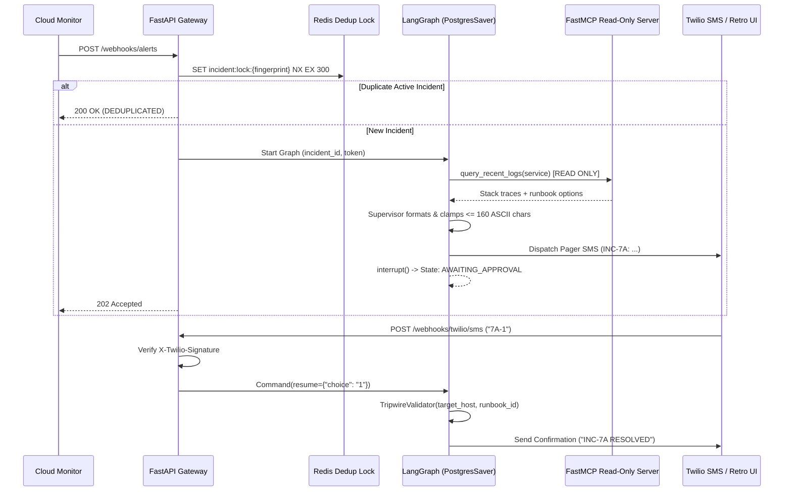

# Design Document: Pagemaster Incident Response System

## Overview
Pagemaster implements a stateful supervisor-worker orchestration graph backed by FastAPI, PostgreSQL, Redis, and the Model Context Protocol (MCP). Deterministic Python gates wrap every LLM boundary to enforce idempotency, 160-character pager formatting, cryptographic webhook verification, and target-host Tripwire isolation.

## Architecture & State Flow

## Correctness Properties

- **Property 1: Pager payload invariant.** For any diagnosis text, `format_pager_payload` returns ASCII text of length <= 160 that starts with `INC-<TOKEN>`, contains both `<TOKEN>-1` and `<TOKEN>-2`, and contains no email, IPv4, IPv6, or bearer token. (Req 3.1, 3.2, 3.3)
- **Property 2: Deduplication idempotence.** For any sequence of alerts sharing a `(service_name, error_code)` fingerprint while an incident is active, exactly one agent run starts and every later alert returns `DEDUPLICATED`. (Req 1.2)
- **Property 3: SMS reply parsing.** `parse_sms_reply` accepts only `<TOKEN>-1` or `<TOKEN>-2` (case and surrounding whitespace tolerant) for a known token and returns no action for any other input. (Req 4.4, 4.5)
- **Property 4: Tripwire soundness.** `TripwireValidator` passes if and only if the target host equals the incident `service_name` and the action ID is in the approved runbook set. (Req 5.2)
- **Property 5: Audit chain integrity and RESOLVED gating.** Each audit record's hash equals SHA-256 of its content plus the previous hash, so any mutation is detected. An incident reaches `RESOLVED` only when `tripwire_check_passed`, `simulated_step_executed`, `confirmation_sms_sent`, and `audit_record_committed` are all true. (Req 5.3, 5.4, 5.5)
- **Property 6: Failed runs end FAILED and free the fingerprint.** For any workflow outcome, `RESOLVED` is persisted only when all four gating flags are true. An executor partial failure (status `EXECUTING` with any flag false), a `RESOLVED` result with a missing flag, or an unhandled workflow exception moves the incident to `FAILED`, appends an audit event, and releases the dedup lock; every terminal state (`RESOLVED`, `BLOCKED_BY_TRIPWIRE`, `FAILED`) frees the fingerprint. (Req 5.4, 5.5, 5.6)

## Persistence and Lifecycle Notes

- `FAILED` is a terminal state. It is excluded from the partial unique indexes `uq_incidents_active_token` and `uq_incidents_active_fingerprint`, and is allowed by the `state` CHECK in `database/init_mock_logs.sql`.
- `IncidentRepository.record_resolution(incident_id, status, gates)` writes the state and the four gate flags in one `UPDATE`, so the `resolved_requires_all_gates` CHECK holds. `None` flags keep their stored value (`COALESCE`). `_run_workflow` reads `gates` from the graph result and uses this method for every state it writes; it never writes `RESOLVED` unless all four flags are true.
- The seed data contains only terminal incidents (`RESOLVED`, `BLOCKED_BY_TRIPWIRE`). Active seeded incidents would hold the dedup fingerprint without a LangGraph checkpoint, so demo alerts would be `DEDUPLICATED` and could not be resumed.
