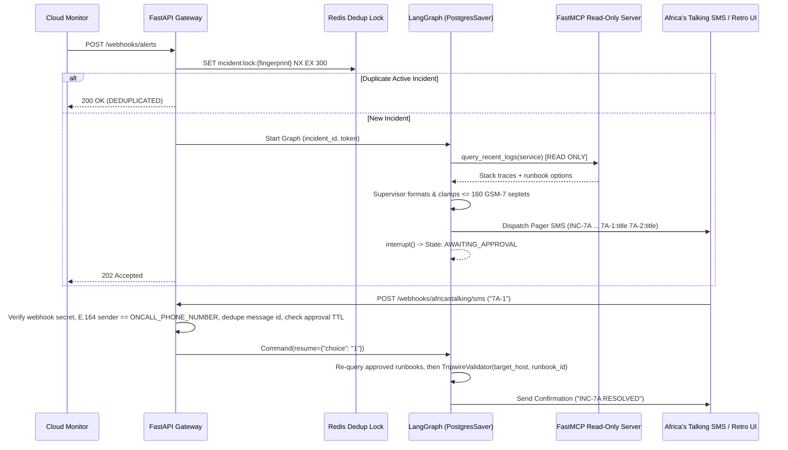

# Design Document: Pagemaster Incident Response System

## Overview
Pagemaster implements a stateful supervisor-worker orchestration graph backed by FastAPI, PostgreSQL, Redis, and the Model Context Protocol (MCP). Deterministic Python gates wrap every LLM boundary to enforce idempotency, 160-septet (GSM-7) pager formatting, webhook authentication with a sender allowlist, and a time-of-check/time-of-use (TOCTOU) safe Tripwire.

## Architecture & State Flow

## Correctness Properties

- **Property 1: Pager payload invariant.** For any diagnosis text, `format_pager_payload` returns ASCII text of length <= 160 that starts with `INC-<TOKEN>`, contains both `<TOKEN>-1` and `<TOKEN>-2`, and contains no email, IPv4, IPv6, or bearer token. (Req 3.1, 3.2, 3.3)
- **Property 2: Deduplication idempotence.** For any sequence of alerts sharing a `(service_name, error_code)` fingerprint while an incident is active, exactly one agent run starts and every later alert returns `DEDUPLICATED`. (Req 1.2)
- **Property 3: SMS reply parsing.** `parse_sms_reply` accepts only `<TOKEN>-1` or `<TOKEN>-2` (case and surrounding whitespace tolerant) for a known token and returns no action for any other input. (Req 4.4, 4.5)
- **Property 4: Tripwire soundness.** `TripwireValidator` passes if and only if the target host equals the incident `service_name` and the action ID is in the approved runbook set. (Req 5.2)
- **Property 5: Audit chain integrity and RESOLVED gating.** Each audit record's hash equals SHA-256 of its content plus the previous hash, so any mutation is detected. An incident reaches `RESOLVED` only when `tripwire_check_passed`, `simulated_step_executed`, `confirmation_sms_sent`, and `audit_record_committed` are all true. (Req 5.3, 5.4, 5.5)
- **Property 6: Failed runs end FAILED and free the fingerprint.** For any workflow outcome, `RESOLVED` is persisted only when all four gating flags are true. An executor partial failure (status `EXECUTING` with any flag false), a `RESOLVED` result with a missing flag, or an unhandled workflow exception moves the incident to `FAILED`, appends an audit event, and releases the dedup lock; every terminal state (`RESOLVED`, `BLOCKED_BY_TRIPWIRE`, `FAILED`) frees the fingerprint. (Req 5.4, 5.5, 5.6)

## Persistence and Lifecycle Notes

- `FAILED` is a terminal state. It is excluded from the partial unique indexes `uq_incidents_active_token` and `uq_incidents_active_fingerprint`, and is allowed by the `state` CHECK in `database/init_mock_logs.sql`.
- `IncidentRepository.record_resolution(incident_id, status, gates)` writes the state and the four gate flags in one `UPDATE`, so the `resolved_requires_all_gates` CHECK holds. `None` flags keep their stored value (`COALESCE`). `_run_workflow` reads `gates` from the graph result and uses this method for every state it writes; it never writes `RESOLVED` unless all four flags are true.
- The seed data contains only terminal incidents (`RESOLVED`, `BLOCKED_BY_TRIPWIRE`). Active seeded incidents would hold the dedup fingerprint without a LangGraph checkpoint, so demo alerts would be `DEDUPLICATED` and could not be resumed.

## Property 7-10 (added with the hardening pass)

- **Property 7: Single-SMS septet budget.** For any diagnosis text and any two runbook titles, `format_pager_payload` returns text with `gsm7_septets(text) <= 160`, no character outside GSM-7 (so no UCS-2 fallback), the `INC-<TOKEN>` prefix, and both `<TOKEN>-1:<title>` and `<TOKEN>-2:<title>` action entries. Extension characters count 2 septets. (Req 3.1, 3.2, 3.3)
- **Property 8: Sender authorization.** A reply changes incident state only if the webhook secret matches, the E.164-canonicalized `from` equals `ONCALL_PHONE_NUMBER`, the optional `to` matches the shortcode, and the message `id` has not been processed before. Any other input is rejected with zero state changes. (Req 4.2 to 4.5)
- **Property 9: TOCTOU Tripwire.** The Tripwire re-queries the approved runbooks for the incident `service_name` at execution time. For any runbook revocation between triage and execution, an action that is no longer approved ends in `BLOCKED_BY_TRIPWIRE` with no execution. (Req 5.2)
- **Property 10: Expiry and reconciliation.** For any approval age greater than `APPROVAL_TTL_SECONDS`, a reply performs no mutation and the incident ends `EXPIRED`. Startup reconciliation moves every `TRIAGING` or `EXECUTING` incident to `FAILED`. Both transitions release the fingerprint lock. (Req 6.1 to 6.5)

## SMS Transport: Africa's Talking

- `AfricasTalkingSmsAdapter` (in `backend/app/services/africastalking_client.py`) implements the `SmsPort` protocol with `httpx.AsyncClient`. It targets the sandbox or production endpoint depending on settings and reads `AFRICASTALKING_USERNAME`, `AFRICASTALKING_API_KEY`, `AFRICASTALKING_SHORTCODE`, and `ONCALL_PHONE_NUMBER`. With `DRY_RUN=true` it writes to the in-memory outbox and makes no network call.
- Africa's Talking does not sign inbound callbacks, so the inbound webhook is authenticated by a shared secret (`AFRICASTALKING_WEBHOOK_SECRET`, constant-time comparison) plus an allowlist: the canonical E.164 sender must equal `ONCALL_PHONE_NUMBER`, and the `to` shortcode must match when configured. The AT message `id` is stored for idempotency so redelivered callbacks do nothing.
- The reply `token` is a bearer-like capability, so it never appears in `GET /api/incidents` or in audit payloads returned over the API. The demo UI learns the token from the dry-run outbox only.

## GSM-7 Septet Budget

- `gsm7_septets(text)` counts GSM 03.38 septets: basic-table characters cost 1 and extension-table characters (`^ { } \ [ ~ ] | €`) cost 2. A string with any character outside both tables would force UCS-2 (70 characters per segment), so such characters are transliterated (smart quotes to ASCII quotes, backtick to apostrophe) or dropped before counting.
- The page format is `INC-<TOKEN> <service>: 
. <TOKEN>-1:<t1> <TOKEN>-2:<t2>`. The summary is truncated first; the prefix, token, and both titled options are always preserved.

## Tripwire TOCTOU, Expiry and Reconciliation

- `tripwire_guard` calls `ports.runbooks.list_approved(service_name)` at execution time. Runbooks cached in state during triage are only used to map the reply digit to an action ID; they are not trusted for authorization. The agent package still depends only on the `RunbookPort` protocol.
- `EXPIRED` is a terminal state (excluded from the active unique indexes and allowed by the `state` CHECK). A lifespan reaper task moves `AWAITING_APPROVAL` incidents older than `APPROVAL_TTL_SECONDS` to `EXPIRED`, and a reply is also checked against the TTL when it arrives.
- On startup, orphaned `TRIAGING` and `EXECUTING` incidents (their in-process background task died with the previous process) are moved to `FAILED`, with an audit event and lock release.

## Operability

- `GET /healthz` returns 200 and backs a Docker `healthcheck` on the `backend` service.
- Postgres and Redis are published on `127.0.0.1` only, Redis requires a password, and `backend/requirements.txt` pins versions.

## Multi-Worker Safety, DB Clock and Header Auth

- **Stale-lease reconciliation:** startup reconciliation fails only `TRIAGING`/`EXECUTING` rows with `updated_at <= now() - make_interval(secs => $1)` (`INFLIGHT_STALE_SECONDS`, default 60, minimum 10), in one `UPDATE ... RETURNING`. A worker that boots while another worker is mid-triage therefore leaves fresh incidents alone. An optional Redis leader lock (`pagemaster:reconcile_lock`, NX, 30 s) serializes concurrent boots. Each reclaimed incident gets an `INCIDENT_FAILED` audit record (`stale_inflight_reconciled`) and its dedup lock released. The in-memory repository mirrors the cutoff.
- **DB-clock expiry:** with PostgreSQL, `expire_stale_awaiting(ttl)` and `expire_if_stale(token, ttl)` compare `updated_at` with `now()` inside SQL and return `is_expired` from the query, so application clock skew cannot extend or shorten the approval window. The reply paths (`/webhooks/africastalking/sms`, `/api/demo/reply`) call `expire_if_stale` before resuming the graph.
- **Header-only callback secret:** the Africa's Talking secret is read from `X-Webhook-Secret`, then `Authorization: Bearer`. `?secret=` is ignored unless `ALLOW_QUERY_SECRET=true`, because URLs end up in proxy and access logs.
- **Property 11:** For any set of `TRIAGING`/`EXECUTING` incidents with arbitrary ages and any cutoff, reconciliation fails exactly those older than the cutoff and leaves younger ones and all other states untouched. (Req 6.4)
- **Property 12:** For any combination of header, bearer and query secrets and `ALLOW_QUERY_SECRET`, a reply is accepted only when a permitted source carries the configured secret. (Req 4.2, 4.3)
